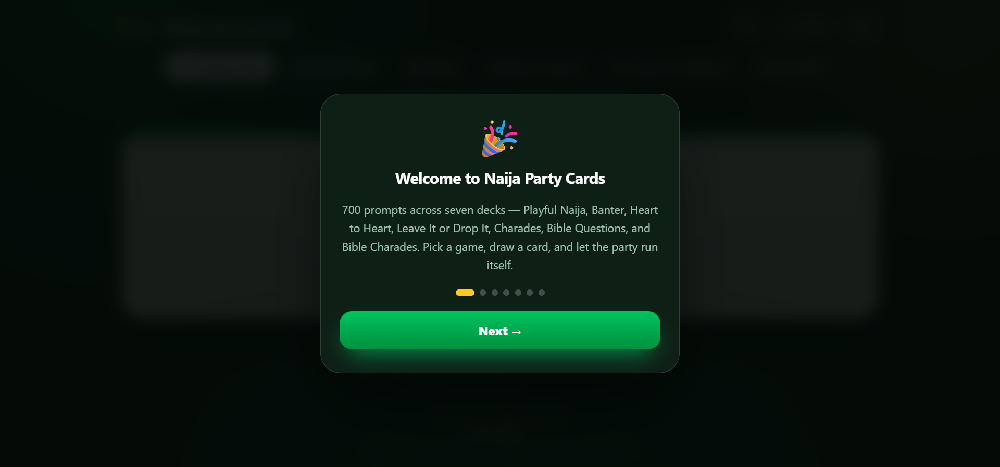

# 🎈 The Hangout

<p align="center">
  
</p>

<p align="center">
  <strong>A single-file, offline-capable party game for friends, family, and hangouts.</strong><br>
  Real-time multi-device sync, live trivia guessing, and a Game Show Podium.
</p>

Built as one HTML file with zero build steps, zero backend, and zero accounts. Drop it on any static host, share the link, and play.

> Looking for the couples version? That lives [here](https://github.com/MmedaraU/couple-games) with its own README.

---

## Features

- **1,418 prompts** across nine decks — Banter, Heart to Heart, Leave It or Drop It, Charades, Bible Trivia & Riddles, Pick Your Poison, Hot Takes, Never Have I Ever, and Confessions.
- **Game Show Mode** — End the game at any time to reveal a 3D Podium of the Top 3 scorers with massive confetti.
- **Live Trivia Guessing** — In Party Mode, guests type their answers on their phones, and the host sees a live feed to award **+1** points for correct guesses.
- **Large Room Support** — The "Force Reveal" button lets the host reveal scoring decks without waiting for AFK players, and the leaderboard is fully scrollable.
- **Real-time Party Mode** — One host, unlimited guests, everyone sees the same card simultaneously. 
- **Action & Dares** — Do or skip prompts with confetti and sound feedback.
- **Scoring Decks** — Never Have I Ever and Confessions let every guest vote privately, then reveal the tally.
- **Mature content warning** — Confessions carries a MATURE badge and soft confirmation.
- **Dark mode** — Light, Dark, and System themes, saved per device, with no flash of light content on load.
- **Fully responsive** — Tuned for phones, tablets, laptops, and landscape orientation.
- **Privacy-first Analytics** — Built-in GoatCounter integration tracks pageviews without cookies or GDPR banners.

---

## Quick Start

### Run locally
1. Download `index.html`.
2. Double-click it to open in any modern browser.
3. Tap **Next Card** to draw. Solo mode works fully offline.

### Run a hangout (Party Mode)
1. Open the file in a browser on the **host device** (a laptop or gaming PC is best for large rooms).
2. Tap **🎉 Party → Host a Party**.
3. Share the 4-character code, link, or QR code with guests.
4. Guests open the link or tap **🔗 Join a Party** and type the code.
5. Draw cards — every connected device mirrors the same card.

*Party Mode needs internet access for the initial WebRTC peer connection. Solo mode does not.*

---

## How to Play

- **Solo / Shared Screen:** Pick a deck, tap **Next Card**, and read the prompt aloud. 
- **Trivia (Solo):** Read the question, tap **💡 Hint** if needed, and **👁️ Reveal Answer**.
- **Scoring (Solo):** Tap **✋ I HAVE** or **🙅 I HAVEN'T** for each player on the screen.
- **Keyboard Shortcuts:** `Space` / `→` = Next Card, `1` = Do, `2` = Leave, `H` = Hint, `A` = Reveal, `S` = Skip Card, `R` = Reset.

---

## The Game Show (Party Mode)

The game is designed to feel like a live game show. 

### 1. The Host Controls the Room
The Host's device acts as the MC. Guests cannot draw cards or reveal answers. The Host can tap **🛑 End Game** at any time to lock the game and trigger the Podium.

### 2. Live Trivia
When a Bible Trivia or Riddle card is drawn, guests see a text box to type their guess. The Host sees a **Live Guesses** feed on their screen. After tapping **Reveal**, the Host can tap the green **+1** button next to any correct answer to instantly award points and fire confetti.

### 3. Force Reveal (Big Rooms)
Waiting for 20 people to tap "I HAVE" is a nightmare. On scoring decks, the Host's Reveal button shows the tally (e.g., `Reveal (5/8 voted)`). The Host can reveal at any time, skipping the AFK players.

### 4. The Podium
When the Host ends the game, every device displays a 3D Podium showing the Gold, Silver, and Bronze winners. The Host can tap **Play Again** to reset the scores and start fresh.

---

## The Decks

| Deck                   | Emoji | Count   | Style                                                                | In Classic Mix |
| ---------------------- | ----- | ------- | -------------------------------------------------------------------- | -------------- |
| Banter                 | 🍿     | **175** | Would-you-rather, playful roast prompts                              | ✅              |
| Heart to Heart         | 💗     | 100     | Deep questions on perception, connection, and reflection             | ❌              |
| Leave It or Drop It    | 🔥     | 85      | Dares, performances, reveals                                         | ✅              |
| Charades               | 🎭     | **200** | Act-it-out prompts — daily life, reactions, professions              | ❌              |
| Bible Trivia & Riddles | ✝️     | **254** | 164 direct questions + 90 riddles, all with hints                    | ✅              |
| Pick Your Poison       | ☠️     | **239** | Two bad options — pick the one you can live with                     | ✅              |
| Hot Takes              | 🔥     | **187** | Debate prompts — relationships and real life                         | ✅              |
| Never Have I Ever      | 🫣     | 90      | Friends-edition confessions, finger scoring                          | ❌              |
| Confessions            | 😏     | 88      | Cheekier friend confessions, finger scoring. **MATURE**              | ❌              |
| **Classic Mix**        | 🎲     | **955** | Banter + Leave It or Drop It + Trivia + Pick Your Poison + Hot Takes | —              |

### Card Behaviour
- **Plain:** No buttons (just answer the prompt).
- **Action:** 💪 I DO AM · 🙅 I LEAVE AM.
- **Trivia:** 💡 Hint · 👁️ Reveal Answer (Host only in Party Mode).
- **Scoring:** ✋ I HAVE · 🙅 I HAVEN'T.

---

## Technical Stack & Customization

- **Stack:** HTML, CSS, Vanilla JavaScript. No frameworks, no build steps.
- **Sync:** WebRTC via [PeerJS](https://peerjs.com/).
- **Audio/Visuals:** Canvas 2D (confetti) and Web Audio API (synthesized sounds).
- **Analytics:** [GoatCounter](https://www.goatcounter.com/) (privacy-first, cookieless).

### Customizing the Game
All content is managed in three objects near the top of the `<script>` tag in `index.html`:
- `RAW`: The actual prompt arrays. Use plain strings for questions, or `{ text: "...", answer: "...", hint: "..." }` for trivia.
- `DECKS`: Defines the deck labels, emojis, colors, and whether they are `scoring` or `mature`.
- `RAW_SOURCES`: Maps merged decks to their underlying arrays.
- `FILTERS`: Defines what appears in the game selection menu.

### Setting up Analytics
The GoatCounter script is located just before the `</body>` tag. Replace `YOURCODE` with your actual GoatCounter subdomain:
```html
<script data-goatcounter="https://YOURCODE.goatcounter.com/count" async src="//gc.zgo.at/count.js"></script>
```

---

## Deployment

Everything lives in a single HTML file. Host it anywhere static. **HTTPS is required for Party Mode** (WebRTC).

- **GitHub Pages:** Commit the file, go to Settings → Pages, and select your branch.
- **Netlify:** Drag the folder onto [app.netlify.com/drop](https://app.netlify.com/drop).
- **Vercel:** Run `vercel --prod` in the directory.

To test locally, run `python3 -m http.server 8080` and visit `http://localhost:8080`.

---

## Troubleshooting

**Guests can't connect**
- Confirm both devices are online and the site is served over HTTPS.
- Some corporate or public Wi-Fi blocks WebRTC — try a mobile hotspot.

**Trivia Guess box is not showing**
- Trivia guessing only works in Party Mode. In Solo mode, the host just reads the answer aloud.
- Ensure the Host has not already revealed the answer.

**Reveal button won't enable on scoring decks**
- The button says `Reveal (X/Y voted)`. If someone leaves without voting, the Host can tap **⏭️ Skip this card** or just tap Reveal anyway (Force Reveal).

---

## Browser Support

| Browser                           | Solo | Party Mode | Dark Mode |
| --------------------------------- | ---- | ---------- | --------- |
| Chrome / Edge (desktop + Android) | ✅    | ✅          | ✅         |
| Safari (macOS + iOS)              | ✅    | ✅          | ✅         |
| Firefox                           | ✅    | ✅          | ✅         |
| Samsung Internet                  | ✅    | ✅          | ✅         |

---

## License

Free to use, modify, and share for personal hangouts and community events.

Prompt content is original and written for this project. If you redistribute, a credit link back is appreciated but not required.

<p align="center">
  Enjoy the hangout. 🎈
</p>